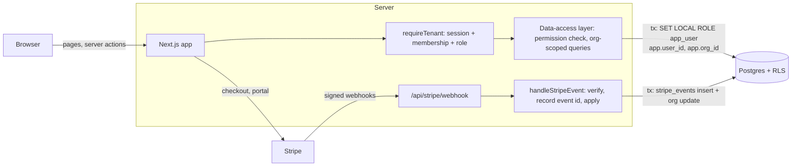

# SaaS Starter

A multi-tenant SaaS foundation built with Next.js, Postgres and Stripe. It covers the parts most B2B products need on day one and tend to get wrong: organisations and roles, invitations, tenant isolation, subscriptions, and plan limits.

It is deliberately small. Each piece is done properly rather than every possible feature being stubbed in.

**What's included**

- **Organisations, members, roles.** Owner, admin and member, with a single permission table. Invitations go out by email with a hashed, single-use, expiring token.
- **Tenant isolation, twice.** The data-access layer scopes every query to the current organisation, and Postgres row-level security enforces the same rule underneath it.
- **Stripe subscriptions (test mode).** Checkout, the customer portal, and a webhook that is signature-verified, idempotent and tolerant of out-of-order delivery.
- **A plan-limited feature.** Projects: 3 on Free, 100 on Pro. The limit holds under concurrent requests. Seats are limited the same way.
- **Admin page.** Every organisation with its plan, subscription status and usage, visible to platform admins only.
- **Sign-in.** Email magic link and GitHub OAuth via Auth.js, each switched on by configuration.

**Stack:** Next.js 16 (App Router, server actions, TypeScript strict), Postgres 17, Drizzle ORM, Auth.js v5, Stripe, Tailwind CSS v4, Vitest, Playwright, GitHub Actions.

## Architecture



A request goes through three gates:

1. **`requireTenant(slug)`** resolves the session user and their membership in the organisation named in the URL. If they are not a member, the page 404s. The result is a `TenantContext` (`userId`, `orgId`, `role`). It is the only way into tenant data.
2. **The DAL** (`src/server/dal/*`) checks the role against the permission table (`src/server/auth/permissions.ts`), validates input, and runs org-scoped queries.
3. **Postgres** runs those queries as a low-privilege role with row-level security, so a missing `where org_id = …` returns nothing instead of another customer's data.

```
src/
  app/                  routes: landing, sign-in, dashboard, /o/[slug]/*, invite, admin, API
  server/
    auth/permissions.ts the role → permission table and role-change rules (pure, unit-tested)
    billing/            plans + limits, Stripe client, webhook handler (pure) + Postgres store
    dal/                all database access; tenant work goes through withTenant()
    session.ts          requireUser / requireTenant / requirePlatformAdmin
  db/                   Drizzle schema, migrator, seed
drizzle/                SQL migrations; 0001_rls.sql holds the role, grants and policies
tests/unit              permissions, plan gating, webhook idempotency and signatures
tests/integration       tenant isolation and RLS against a real Postgres
e2e/                    Playwright smoke test
```

## Key decisions

### Tenant isolation in the DAL, with RLS as a second line

Most multi-tenant data leaks are a query that forgot its tenant filter. The usual fix is "be careful". I prefer two independent layers:

- **The DAL is the primary control.** Pages and server actions never touch the database directly. Every DAL function takes a `TenantContext`, checks the permission, and filters by `org_id` explicitly. That keeps the rules readable, testable and close to the business logic.
- **RLS is defence in depth.** Each tenant transaction sets `app.user_id` and `app.org_id` with `set_config(…, true)` and then `SET LOCAL ROLE app_user`. Both are transaction-local, so nothing leaks to the next request on a pooled connection. `app_user` has column-level grants and per-table policies, so even with a buggy query it can only see organisations it belongs to and only write to the current one. It cannot write billing columns at all; only the webhook can.

Why not RLS alone? Policies are hard to review and fail silently: a wrong policy returns empty results rather than an error. Why not the DAL alone? One missed filter is a breach. With both in place, a mistake in either one is caught by the other. `tests/integration/tenancy.test.ts` runs deliberately unfiltered queries to prove the RLS layer catches them.

A few paths have no tenant context and use the privileged connection on purpose. Each is marked in the code: creating an organisation, previewing and accepting an invitation, the Stripe webhook, linking a Stripe customer, and the admin page.

### Idempotent, order-tolerant webhooks

Stripe delivers events at least once, sometimes concurrently, and in no guaranteed order. The handler (`src/server/billing/webhook.ts`):

1. **Verifies the signature** against the raw request body before parsing anything. A bad signature returns 400.
2. **Records the event id and applies its effects in one transaction.** `insert into stripe_events … on conflict do nothing` decides whether this delivery is the first. A redelivery is a no-op that returns 200. If processing fails, the event id rolls back with the effects, so Stripe's retry gets a clean second attempt. Recording first and processing later would lose events; processing first and recording later would double-apply them.
3. **Ignores stale state.** Each organisation stores the timestamp of the last billing event applied, and an older event cannot overwrite a newer one. A late `subscription.updated (active)` will not resurrect a cancelled subscription.

The handler takes a small `BillingStore` interface, so its logic is unit-tested against an in-memory store with the same transaction semantics. The Postgres store, including concurrent duplicate delivery, is covered by an integration test.

### Plan limits that hold under concurrency

"Count, then insert" lets two simultaneous requests both pass the check. Limit checks take a transaction-scoped advisory lock per organisation (`pg_advisory_xact_lock`), so they run one at a time for that organisation and never block anyone else. The integration suite fires six concurrent creates at a Free organisation and expects exactly three to succeed. Open invitations count towards seats.

`past_due` keeps Pro features on: Stripe is still retrying the card, and locking a paying customer out during dunning does more harm than a few days of grace. Downgraded organisations keep their data but cannot add more.

### Smaller choices

- **Roles are data.** The permission table is one object. Role-change rules are pure functions: only owners create owners, admins manage members only, nobody promotes themselves, and an organisation always keeps at least one owner. Membership changes take the same per-organisation lock, so two owners cannot demote each other at the same time and leave none.
- **Database sessions**, so signing out or removing a user takes effect immediately.
- **Invitation tokens** are stored as SHA-256 hashes, expire after 7 days, are single use, and only work for the email they were sent to.
- **No test-only backdoors.** The e2e test signs in by creating a session row in the database, the same thing Auth.js does after a magic-link click.

## Run locally

Requirements: Node 22+, and Docker (or any Postgres 15+).

```bash
git clone https://github.com/noamtzu/saas-starter.git
cd saas-starter
npm install
cp .env.example .env            # then set AUTH_SECRET (openssl rand -base64 32)
docker compose up -d            # Postgres on :5432
npm run db:setup                # migrations + demo data
npm run dev                     # http://localhost:3000
```

Sign in with any email. Without `EMAIL_SERVER` the magic link is printed in the terminal running `npm run dev`. To see real emails, run `docker compose --profile mail up -d`, set `EMAIL_SERVER=smtp://localhost:1025` and open http://localhost:8025.

Demo data (all `@example.com`):

| Email                | What you see                                               |
| -------------------- | ---------------------------------------------------------- |
| `owner@example.com`  | Owner of Acme (Free, 2/3 projects) and Globex (Pro)        |
| `member@example.com` | Member of Acme: cannot invite, delete or manage billing    |
| `admin@example.com`  | Platform admin: `/admin`                                   |

**Stripe (optional, test mode).** Create a recurring price in test mode and put `STRIPE_SECRET_KEY` and `STRIPE_PRICE_PRO` in `.env`. Then forward webhooks with the Stripe CLI and copy the printed `whsec_…` into `STRIPE_WEBHOOK_SECRET`:

```bash
stripe listen --forward-to localhost:3000/api/stripe/webhook
```

Use card `4242 4242 4242 4242` at checkout. Without Stripe keys the billing page explains what is missing and everything else works.

**GitHub sign-in (optional).** Create an OAuth app with the callback URL `http://localhost:3000/api/auth/callback/github` and set `AUTH_GITHUB_ID` and `AUTH_GITHUB_SECRET`.

**Production note.** The RLS migration creates the `app_user` role, so the migrating database user needs `CREATEROLE` (managed Postgres usually grants this to the owner role). The app connects as that same user and drops to `app_user` per transaction.

## How to test

```bash
npm run lint
npm run typecheck
npm test                    # unit: permissions, plan gating, webhook idempotency + signatures
npm run test:integration    # tenant isolation + RLS; needs DATABASE_URL and migrations
npm run e2e                 # Playwright smoke test; needs a migrated database
```

| Suite       | What it covers                                                                                                                                      |
| ----------- | --------------------------------------------------------------------------------------------------------------------------------------------------- |
| Unit        | The full role × permission matrix, role-change and removal rules, plan resolution and limits, webhook redelivery, rollback and retry, out-of-order events, signature verification |
| Integration | Cross-tenant reads and deletes through the DAL, RLS blocking unfiltered queries and cross-tenant inserts, billing columns not writable, no settings leak across pooled connections, concurrent plan limits, invitations, concurrent webhook delivery |
| e2e         | A new user creates an organisation, adds projects up to the Free limit, sees the upgrade path; signed-out users are redirected                       |

CI (`.github/workflows/ci.yml`) runs lint, typecheck and unit tests with coverage, a production build, and then integration and e2e tests against a Postgres service container on every push and pull request.

## How I deliver this kind of work for clients

- **Scoped milestones.** Work is split into milestones of a week or two, each with a written definition of done and a demo. You can stop or change direction at any milestone boundary.
- **Tests first where it matters.** Permissions, billing and tenant isolation get tests before the UI. Those areas are where bugs cost money or trust, and where tests are cheapest to write.
- **A pull request per feature.** Small PRs with a description of what changed and why, CI green before review, and nothing merged that you have not been able to look at.
- **A handover document.** At the end you get how to run, deploy and extend the system, the decisions made and their trade-offs, and known limits. The goal is that your team can own it without me.

## License

MIT. See [LICENSE](LICENSE).
